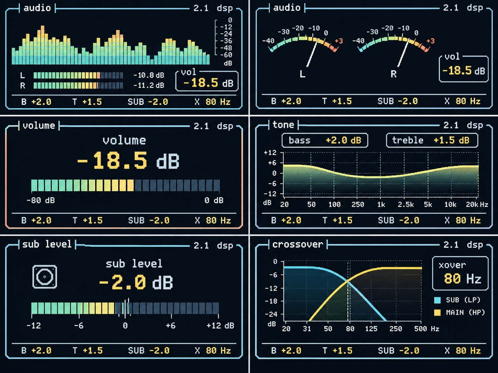

# Front panel and display UI

**Status:** interaction and display specification. The control electronics,
display controller, DSP protocol, and final enclosure layout remain to be
implemented.

The amplifier uses a 2.4-inch, 320 × 240 colour display controlled by an
RP2350. It is an instrumentation display, not a menu system: the physical
control being used determines the display context, and the display returns to
the selected playback visualisation after a short idle timeout.

## Controls

| Control | Action | Result |
| --- | --- | --- |
| Main rotary encoder with push switch | Rotate | Adjusts master volume by default, or the parameter selected by an adjustment button |
| `BASS` | Press | Assigns the encoder to bass and opens the tone screen |
| `TREBLE` | Press | Assigns the encoder to treble and opens the tone screen |
| `SUB` | Press | Assigns the encoder to subwoofer trim and opens the sub-level screen |
| `XOVER` | Press | Assigns the encoder to crossover frequency and opens the crossover screen |
| `DISPLAY` | Press | Cycles spectrum, stereo VU, and stealth playback modes; the selection persists across power cycles |
| `DISPLAY` | Long press | May toggle reduced display brightness |
| `MUTE` | Press | Toggles mute immediately, regardless of the current display context |

An adjustment-button press takes effect immediately; there is no confirmation
or navigation step. The encoder always reverts to master-volume control after
2.5 seconds without adjustment input. Its first movement after that timeout
therefore changes volume.

## Display states

### Playback visualisations

- **Spectrum:** 24–32 logarithmically spaced bands from approximately 20 Hz to
  20 kHz, segmented bars, peak hold, and cyan/green/yellow/orange level colour.
- **Stereo VU:** independent left and right analogue-style meters with a dB
  scale and peak indication.
- **Stealth:** mostly static status and master-volume information; no
  continuously animated visualisation.

### Adjustment screens

| Context | Main content |
| --- | --- |
| Volume | Large dB value, segmented attenuation bar, and mute indication |
| Bass or treble | Shared logarithmic tone-response graph, with the active value highlighted |
| Sub level | Large signed dB value and a centred segmented bar relative to 0 dB |
| Crossover | Main high-pass and subwoofer low-pass response graph with the selected frequency marked |

Every screen maintains a compact header (amplifier identity, DSP state, and
master volume) and a footer (`B`, `T`, `SUB`, `X`) showing the current settings.
The UI displays the values acknowledged by the DSP, rather than treating local
encoder state as authoritative.

## Visual reference

This user-provided image records the intended visual direction for future UI
work: pixel-style typography, cyan instrumentation frames, segmented meters,
and graph-led adjustment views. It is reference material rather than a final
screen layout, parameter specification, or firmware asset; final screens must
remain legible within the 320 × 240 display target.

## Visual language and layout

The design follows the attached retro-terminal reference: near-black navy
background, one-pixel cyan or pale-blue panel borders, bitmap-style monospace
text, segmented indicators, and fine graph gridlines. Green denotes normal
levels; yellow indicates active values or high level; orange is reserved for
peaks, warnings, and clipping. Text is light grey/white. Use integer-aligned
geometry and bitmap fonts; avoid gradients, shadows, glossy effects, and
nonessential animation.

For the 320 × 240 target, reserve a 20-pixel header, a 24-pixel footer, and
6-pixel outer margins. The resulting 320 × 190 content region supports a
single full-width panel with a 1-pixel border. Renderer-specific layout
constants are defined in `firmware/mcu/src/ui/screen_layout.hpp`.

## Electrical and firmware implications

Reserve GPIO for the encoder's A/B channels and push switch, six panel buttons
(`BASS`, `TREBLE`, `SUB`, `XOVER`, `DISPLAY`, `MUTE`), display control, DSP
communication, and SWD. Audio-level and spectrum data must be exposed by the
DSP when animated playback modes are enabled. The UI still remains usable with
stealth mode while such telemetry is unavailable.

The display module's controller, interface, refresh method, supply/current
requirements, and mounting dimensions need confirmation before the MCU sheet
and enclosure are finalized. Keep display and fast digital signals separated
from sensitive analogue audio paths.

The prior five-control, seven-segment concept is retained only as a historical
reference at `docs/archive/front-panel-seven-segment.svg`; it is not the active
front-panel design.
