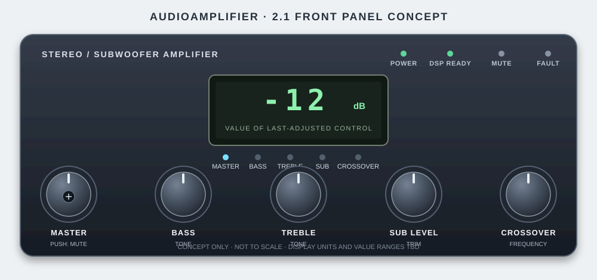

# Front-panel concept

**Status:** revisable UI proposal; dimensions, component types, parameter
ranges, and MCU are not yet finalized.

## Controls

Use five detented rotary encoders with labels and a shared numeric display:

| Control | Function | Display convention (proposed) |
| --- | --- | --- |
| Master | Shared level for left, right, and subwoofer outputs | Attenuation in dB or a normalized percentage; choose one convention |
| Bass | Low-frequency EQ adjustment | Signed dB relative to neutral |
| Treble | High-frequency EQ adjustment | Signed dB relative to neutral |
| Sub level | Additional subwoofer trim on top of shared master volume | Signed dB relative to neutral |
| Crossover | Shared stereo high-pass / subwoofer low-pass cutoff | Frequency in Hz |

The display shows the value of the last-adjusted control. A labeled LED beside
each parameter indicates what is currently displayed; it stays on briefly
after a change, then may return to a default selection (suggested: Master).
Print the parameter labels and their units (`%` or `dB` for level controls,
`Hz` for crossover) on the physical panel so users can read a value at a glance.
Four digits limit how values can be formatted: for example, signed whole-dB
values fit more easily than signed tenths. Confirm resolution and range before
choosing a display format.

The master encoder push switch toggles mute. The MCU should ramp gain smoothly
for mute/unmute and manage amplifier enable sequencing to reduce pops; do not
rely on a display/LED alone as a mute state indicator.

## Indicators

- **POWER:** logic/control supply is present.
- **DSP READY:** DSP has completed the selected boot/configuration sequence and
  parameter communication is available.
- **MUTE:** audio is intentionally muted, including during startup if desired.
- **PROTECT / FAULT:** only populate or label this if the design actually
  monitors amplifier fault signals or another protection condition. If only
  amplifier fault pins are monitored, label the indicator accordingly.

Avoid separate meters, menus, or a display per knob in the first version. This
keeps the panel direct while still showing which parameter the numeric value
belongs to.

## Control behavior to implement

1. On power-up, keep the amplifier muted, initialize the DSP and MCU controls,
   load validated defaults or saved settings, then indicate DSP Ready and
   unmute with a controlled ramp.
2. Rotate an encoder to change its parameter. Light the corresponding
   parameter LED and show the updated value.
3. Master volume applies to all outputs. Sub level is an additional trim on
   the subwoofer path, not an independent subwoofer master.
4. Bass and treble adjustments should have documented limits and neutral
   positions. Crossover adjustment should be limited to a range verified for
   the selected filters and speakers.
5. Smooth parameter changes, especially cutoff/coefficient updates, to avoid
   zipper noise, clicks, unstable coefficients, or temporary loss of headroom.
6. If settings are saved in MCU nonvolatile memory, debounce writes: save after
   adjustment has stopped rather than on every encoder step. Define behavior
   for first boot and invalid/corrupt stored settings.
7. Fault indication and response must correspond to real detected signals.
   Define how fault status affects mute and recovery.

## MCU direction

An inexpensive, widely available ARM MCU is the current preference. The
STM32G0 family is the initial candidate; select a specific MCU only after
checking required encoder inputs, timers, display-driving interface, control
bus, nonvolatile settings, supply/logic compatibility, package, and availability.

A J-Link EDU is available for development/debug. Confirm the selected STM32
part's SWD pinout and target-voltage requirements, reserve SWDIO/SWCLK/NRST
access on the board, and check the probe's licensing terms for the intended
project use. The J-Link is a development tool, not a required product component.

## Display implementation options

For a four-digit seven-segment display, compare:

- a small serial display-driver IC, minimizing MCU pin count and firmware
  multiplexing work; or
- direct MCU multiplexing, if the selected package has enough GPIO and the
  segment-current, refresh, and brightness requirements are modest.

Choose common-anode/common-cathode display type, driver, LED current, brightness,
and decimal-point/unit scheme together. The selected parameter LED and printed
unit legend should make units unambiguous. Confirm readability in the intended
lighting and avoid excessive LED current or supply noise near the analog audio
section.

## Not finalized

- Exact display size, digits, driver, units, and brightness.
- Encoder type, detent count, rotation acceleration, and push-switch behavior
  beyond master mute.
- Parameter ranges, step sizes, defaults, and saved-setting policy.
- Exact STM32G0 device/package and firmware update/programming connector.
- DSP boot method, control protocol configuration, parameter addresses, and
  update/smoothing implementation.
- Which amplifier fault signals are monitored and what recovery behavior is
  required.
